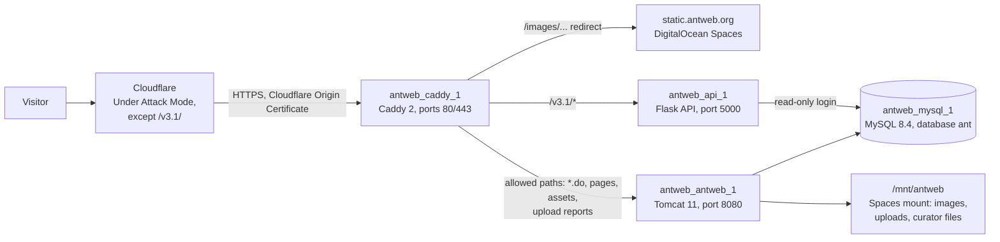
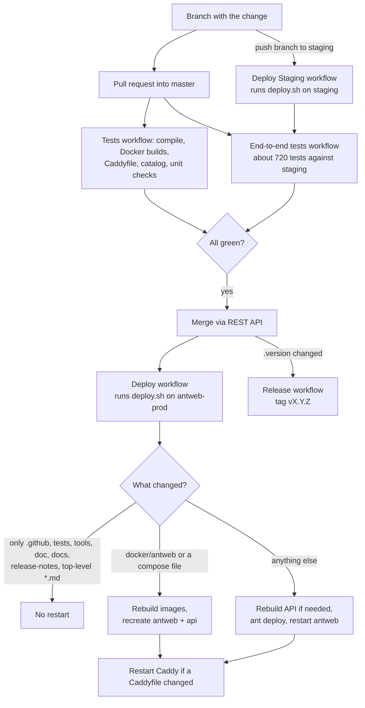

# AntWeb architecture overview

Written 2026-10-18 from the project's working instructions and the code on master (5b0c1d5). Where an older document (`docs/ARCHITECTURE.md`, `doc/`) disagrees with this page, this page is current. Day-to-day procedures are in [runbook.md](runbook.md).

## In plain language

AntWeb runs on one DigitalOcean server (droplet) for the public site and one smaller droplet for staging, where every change is tried first. Each droplet runs four Docker containers: a web server (Caddy) that receives all traffic, the AntWeb application (Java, in Tomcat), the database (MySQL) and a small read-only data API (Python). Cloudflare sits in front of the site: visitors never reach the droplet directly. Specimen images are not served by the droplet at all; they live in DigitalOcean Spaces (cloud file storage) and are served from static.antweb.org.

Every night at 5 AM Pacific the application refreshes itself: it imports the latest ant names from AntCat (built by a separate AntCat export droplet), uploads the Academy's own specimens from TaxonWorks, and recomputes the counts and maps behind the country, museum and bioregion pages. This runs until about 8 AM.

Code lives on GitHub. A change is made on a branch, tried on staging with an automatic test suite (about 720 checks), then merged into `master`, which deploys production automatically. The deploy restarts the application only when something it runs has changed; a restart takes 2 to 4 minutes before pages load again.

The database is copied to Spaces every night (kept a week) and on the first of each month (kept a year). DigitalOcean emails Brian when a droplet runs out of CPU, memory or disk, or when the site stops answering.

## Servers

All droplets run Ubuntu 24.04 LTS. AntWeb itself uses the first two; the AntCat droplets are listed because AntWeb depends on the export.

| Droplet | Address | Role |
|---|---|---|
| antweb-prod | 165.232.137.86 (reserved IP 64.225.91.165) | www.antweb.org; 16 GB RAM; project folder `/root/antweb` |
| antweb staging | 165.232.136.170 | staging.antweb.org; 4 GB RAM; project folder `/root/antweb-next` (`/root/antweb` is a link to it). Memory is tight, so the nightly run skips set 5 here. |
| antcat-prod | 147.182.238.155 | www.antcat.org (separate repository) |
| antcat-staging | 143.244.182.132 | AntCat staging, not public |
| antcat-export | 165.232.141.186 | Builds `antcat.antweb.txt` every night for AntWeb (see "The AntCat feed") |

Firewall: the DigitalOcean firewall on the AntWeb droplets accepts web traffic (80/443) only from Cloudflare's address ranges; SSH is open; the droplets' private network (10.124.0.0/20) is open between them.

## Request path

1. **Cloudflare** (DNS, TLS to visitors, bot protection). antweb.org is in Under Attack Mode except paths under `/v3.1/` (the API). Cloudflare's rate-limiting rules are the general per-visitor limit.
2. **Caddy** (`docker/caddy/Caddyfile`; staging: `Caddyfile.staging` + `Caddyfile.common`). Terminates TLS with the Cloudflare Origin Certificate (`/data/cf-origin.*` in the `antweb_caddy_data` volume), adds security headers, refuses listed bots, and then, in order:
   - redirects `/images/<file>` to `https://static.antweb.org/images/<file>` (images come from Spaces, not the droplet);
   - answers 404 for paths that are never served (Tomcat admin apps, `/backup`, `/log`, `/logbak`, working files, `/web/upload/`, private logs under `/web/log/`, folder listings, any `;` in the path, `*.jsp` not on the allow-list);
   - limits `POST /login.do` to 10 a minute per visitor (keyed on `CF-Connecting-IP`);
   - sends `/v3.1/*` to the API container (`api:5000`, prefix stripped);
   - sends the allowed paths (`/`, `*.do`, `*.jsp` on the allow-list, static file types, `/web/log/<report folders>/`, `/specimen/*`, `/web/curator/*`, `/web/bak/taxonSets/*`) to Tomcat (`antweb:8080`);
   - answers 404 for anything else.
   Access log: `docker/caddy/logs/access.log` in the project folder (JSON, 100 MB files, 10 kept).
3. **Tomcat** runs the Struts application (Java 21, Tomcat 11, Struts1 Reloaded) as the user `tomcat` (uid 2001, group `antweb` 2000). Container port 8080 is published on the host only at `127.0.0.1:8081`: host scripts that need the application use that address, never the public one (Cloudflare's challenge page would answer instead).
4. **MySQL 8.4**, database `ant`, published only at `127.0.0.1:3306`. The application logs in with the account in `etc/db.properties`; the API with the read-only account in `etc/api-db.properties`.
5. **API v3.1** (`api/v3.1/api.py`, Flask under gunicorn, 3 workers as the user `api`). Read-only. At most 10,000 records per request (also with `ndjson=true`); larger sets are paged with `offset`. **Every data route (13 of 14) returns an empty 200 response unless the request has `up=1`** (`down()` in `api.py`; only `/` answers without it). This is old behaviour; its purpose is unknown and it is flagged for review in the API part of the documentation phase. The DigitalOcean uptime check uses `/v3.1/`, which does not need it.

## Containers and storage

Defined in `docker-compose.yml`, with `docker-compose.prod.yml` (prod) or `docker-compose.stage.yml` (staging) on top. Compose project `antweb`, so the names are the same on both droplets.

| Container | Image | Published | Notes |
|---|---|---|---|
| `antweb_caddy_1` | `docker/caddy/Dockerfile` (Caddy 2 + rate-limit module) | 80, 443 | Caddyfiles mounted read-only from the repo |
| `antweb_antweb_1` | `docker/antweb/Dockerfile` (tomcat:11-jdk21) | 127.0.0.1:8081 -> 8080 | Java heap up to 40% of RAM (`MaxRAMPercentage=40`); `no-new-privileges`, all capabilities dropped except 7 |
| `antweb_mysql_1` | mysql:8.4 | 127.0.0.1:3306 | Data in the external volume `antweb_database84` (`antweb_database` is the old MySQL 5.7 data, kept for rollback until about 10-27) |
| `antweb_api_1` | `docker/api/Dockerfile` (python:3.12) | none (Caddy reaches it on 5000) | 1 GB memory, 1 CPU, read-only filesystem; sees only `etc/api-db.properties` |

Mounts of `antweb_antweb_1` (left: project folder on the host, unless absolute):

| Host | In the container | What it is |
|---|---|---|
| `build.xml`, `bin/`, `doc/`, `etc/`, `META-INF/`, `src/`, `test/`, `web/`, `WEB-INF/` | `/antweb/deploy/...` (read-only) | The checkout. `ant deploy` builds from here into `/usr/local/antweb` (the running web app). |
| `etc/` | `/antweb/deploy/etc/` (read-only) | Server-only settings files (next section). |
| `logs/` | `/usr/local/tomcat/logs` | Tomcat logs: `catalina.*`, `localhost_access_log.*.txt` (kept 180 days), `antweb.log` and `antwebInfo.log` (log4j, `etc/log4j2.xml`), `detail/` (search, upload, event logs; also the host's `rebootCheck.log`). |
| `logs/web/` | `/usr/local/antweb/web/log` | AntWeb's own logs: `compute.log`, `admin.log`, `taxonworksNightly.log`, `adminTask.log` and others. On the host since 2026-10-18, so rebuilding the container keeps them. The four upload report folders inside (`specimen`, `worldants`, `detail`, `upload`) are links into `/mnt/antweb/web/log/`, made at every start by `antweb-fix-perms`. |
| `logbak/` | `/usr/local/antweb/log` | "Data" logs that are never web-readable, e.g. `emails.log`, `messages.txt`, `serverBusy.html`, `logrotate.log`. |
| `/mnt/antweb` | `/mnt/antweb` | DigitalOcean Spaces bucket mounted by rclone on the host: `images/`, `web/upload/` (archived upload files), `web/curator/`, `web/speciesList/`, `web/workingdir/`, `web/log/<report folders>`, `web/bak/`. |
| `/mnt/backup` | `/mnt/backup` | Second Spaces mount: database dumps (`db/daily`, `db/monthly`, `db/ant-currentDump.sql.gz`), archived logs. |
| volume `antweb_genInc` | `/usr/local/antweb/web/genInc` | Generated page fragments. |

Rotation: `docker/antweb/logrotate.conf`, run at 03:40 daily inside the container as `tomcat`: top-level `*.log` and `*.txt` in `logs/web` and `logbak` rotate weekly once over 10 MB, 26 kept, compressed. The report folders are never rotated. `bin/clearDisk.py` (21:00) deletes dated Tomcat logs 7 to 14 days old and numbered `log.3` to `log.9` copies in `logs/`. Docker keeps 5 x 10 MB of each container's console output (`docker logs`).

## Settings files (`etc/`, server only)

These files are gitignored and exist only on the droplets, in `etc/` of the project folder (prod `/root/antweb/etc`, staging `/root/antweb-next/etc`). The container sees them read-only at `/antweb/deploy/etc/`. They must be readable by group 2000 (`chgrp 2000`, `chmod 640`); `startup.sh` warns in `docker logs` when Tomcat cannot read one. Unless noted, the application re-reads a file within a minute, so a change needs no restart or deploy.

| File | Read by | What it does | Without the file |
|---|---|---|---|
| `db.properties` | `DbCredentials`, the dump scripts | MySQL login of the application (`user=`, `password=`). Read at start. | Falls back to the placeholder in the image: the site cannot reach its database. |
| `api-db.properties` | API (`api.py`), at start | Read-only MySQL login of the API. | API logs in with the placeholder and fails. |
| `mail.properties` | `Emailer` | Amazon SES SMTP settings (`host`, `port`, `username`, `password`, `from`). | No mail is sent; messages are written to `logbak/emails.log`. |
| `turnstile.properties` | `Turnstile` | Cloudflare Turnstile keys for the Create Account form. | Check off; account creation works without it. If present but unverifiable, sign-up is refused. |
| `taxonworks.properties` | `TaxonWorksNightly` | `url=` (TaxonWorks public download link), `curatorId=` (login the upload is made as, 1 = Brian, CAS group), optional `minRatio=` (default 0.95). | The nightly TaxonWorks upload is off. |
| `editor.properties` | `PageEditor` | `pageEditor=ckeditor` puts every curator edit form back on the old CKEditor 3; `tinymce` or no file = TinyMCE 8. | TinyMCE. |
| `scheduler.properties` | `Scheduler`, at the end of each nightly run | `nightlyRestart=true` asks for a container restart after the nightly run (the old behaviour). | No restart after the nightly run (since 2026-10-18). |
| `upload-email.properties` | `UploadNotice` | `enabled=on/off` (default on in production, off on staging), `excludeGroups=` (default 1, CAS), `onlyDomains=` (staging defaults to antweb.org, calacademy.org). | Production: upload-complete emails go to curators except group 1. |
| `flickr.properties` | nothing in the current code | Listed in `.gitignore`; the Flickr code was removed in October 2026. | No effect. |
| `git-commit` | `GitCommit` | Written by `deploy.sh` on every deploy; the commit shown next to the version in the header. | Header shows the version only. |

The `AppRes*Docker.properties` and `log4j2.xml` files in `etc/` are in git and copied into the image at build time (`etc/configDocker.sh`, by `ENV` = PROD or STAGE).

## Scheduled jobs

Jobs live in four places (host system cron, host root crontab, container cron, and the Java scheduler); the full list with commands and logs is in the project's cron reference (`antweb-cron-reference.md`). Summary, Pacific time:

| When | Where | Job |
|---|---|---|
| 01:00 daily | host `/etc/crontab` | `bin/db-daily-dump.sh`: dump of `ant` to `/mnt/backup/db/daily/YYYY-MM-DD.sql.gz` and `db/ant-currentDump.sql.gz`; files older than 7 days deleted. Log `/root/antweb/db-daily-dump.log`. |
| every 5 min | host `/etc/crontab` | `bin/reboot_checker.sh`: asks `http://127.0.0.1:8081/util.do?action=isRestart`; restarts the container on `true` (or on the application's error page, `case#`). |
| hourly at :15 | host root crontab | `/root/antweb-watchdog.sh` (not in git): restarts the container when a Java thread stays above 95% CPU across two samples, the container has been up more than 12 hours, and there was no watchdog restart in the last 6 hours. Log `/var/log/antweb-watchdog.log`. |
| Sundays 04:00 staging, 04:15 prod | host `/etc/cron.d/weekly-security-reboot` | `/usr/local/sbin/weekly-reboot` (not in git): reboots the droplet if Ubuntu flags a reboot or a newer kernel is installed. `journalctl -t weekly-reboot`. |
| 03:40 daily | container cron | logrotate (above). |
| 03:50 Thursdays | container cron | `bin/taxonSetBackup.sh`: geolocale, project, museum and bioregion taxon sets to `/mnt/antweb/web/bak/taxonSets/`. |
| 05:00 daily | Java (`SessionRequestFilter` timer, `Scheduler`) | The nightly sets, below. |
| 21:00 daily | container cron | `bin/admin.sh`: unclosed-connection report and `clearDisk.py`. Log `logs/web/adminTask.log`. |
| 23:00 on the 1st | container cron | `bin/db-monthly-dump.sh`: dump to `/mnt/backup/db/monthly/` (kept 365 days). |

**The nightly sets** (`util/Scheduler.java`, `util/UtilDataAction.java`). The application calls itself on `http://localhost:8080/utilData.do?action=setN` with a one-time secure code, one set after another (each may run up to 4 hours before the call times out). Progress and the Java memory in use go to `compute.log`. On staging set 5 is skipped and the caches are reloaded instead.

| Set | What it does | Production time |
|---|---|---|
| 1 | AntCat import (`worldantsFetchAndReload`, `taxonFinish`), then the CAS TaxonWorks upload (waits up to 90 minutes for a fresh archive) | 12 min + wait + upload |
| 2 | data cleanup; geolocale taxa from specimens; geolocale counts | about 45 min |
| 3 | project counts; museum and bioregion taxa; taxon sets; type specimens | about 15 min |
| 4 | image counts | about 15 min |
| 5 | conflicting default images; object maps; species list proxy cleanup; reload of all caches | about 50 min |

If set 1 is still running 210 minutes after it started (8:30 AM), the application asks for a restart; it never asks while an upload (a curator's or TaxonWorks) is running. Since 2026-10-18 there is no restart after a normal run.

## Email

AntWeb sends from antweb@antweb.org through Amazon SES (us-west-2, production access). Settings in `etc/mail.properties`. Limits in `Emailer`: alerts at most once an hour per subject and 100 a day; password-reset mail 2,000 a day; notices (upload complete) 20 a day per address, 500 a day in all. On staging, subjects are prefixed with the host name and upload notices go only to antweb.org and calacademy.org addresses. Incoming mail to antweb@antweb.org is forwarded to bfisher@calacademy.org by Cloudflare Email Routing.

Curators get an email when their specimen or image upload finishes or fails, except group 1 (CAS) and the nightly TaxonWorks upload (`upload/UploadNotice.java`).

## The AntCat feed

antcat-export runs `export_database.sh` at 03:00 and serves `antcat.antweb.txt` on port 9090. At 05:00 set 1 downloads it from `http://antcat-export:9090/antcat.antweb.txt` (`curate/speciesList/SpeciesListUploader.java`); the name `antcat-export` is mapped to the export droplet's private address in `docker-compose.prod.yml` and `docker-compose.stage.yml`. The import result is in `admin.log` and the Worldants upload report.

## Monitoring and alerts

DigitalOcean monitoring, emails to bfisher@calacademy.org only:

| Alert | Condition |
|---|---|
| CPU | antweb-prod or antcat-prod above 90% for 1 hour |
| Memory | a prod droplet above 90% for 30 minutes |
| Disk | any droplet's disk above 85% for 30 minutes |
| Disk read | antweb-prod reading above 90 MB/s for 1 hour |
| Uptime | `https://www.antweb.org/v3.1/` or `https://www.antcat.org/v1/taxa/429011` down from all 4 regions for 10 minutes |

Inside the droplet, `reboot_checker.sh` and the watchdog restart the application on its own request or on a stuck thread. Joe Russack's Zabbix (CAS IT) watches antcat.org only. What to do for each alert: [runbook.md](runbook.md#alerts).

## Deploy pipeline

- **Workflows** (`.github/workflows/`): `tests.yaml` on every pull request into master (Java compile against Tomcat 11, Docker builds, Caddyfile and compose checks, function catalog check, API and image-handling unit checks); `e2e.yaml` on pull requests into master, daily at 13:17, or by hand (runs against staging through an SSH tunnel, one run at a time); `deploy-staging.yaml` on every push to the `staging` branch; `deploy.yaml` on every push to `master`; `release.yaml` when `.version` changes on master.
- **deploy.sh** (`.github/scripts/deploy.sh`, run over SSH in `/root/antweb`): fetches and pulls the branch, writes the commit to `etc/git-commit`, then:
  - stops there (no restart) when every changed file is under `.github/`, `tests/`, `tools/`, `doc/`, `docs/`, `release-notes/` or is a top-level `*.md` (checked by `tests/unit/test_deploy_paths.py`);
  - when `docker/antweb/`, `docker-compose.yml` or `docker-compose.stage.yml` changed: rebuilds the antweb image (the old container keeps serving during the build), copies web/log to the host the first time it is needed, recreates the antweb and api containers;
  - otherwise: removes jars no longer in `WEB-INF/lib`, restarts first if `build.xml` changed, rebuilds the API image if `api/` changed, runs `ant deploy` as `tomcat`, restarts antweb;
  - in both restart paths, restarts Caddy if the running Caddyfile differs from the repo's.
- **Merging** is done with the GitHub REST API (`gh api -X PUT repos/calacademy-research/antweb/pulls/N/merge`).
- **Releases**: one PR that bumps `.version` and `web/documentation/releaseNum.jsp` and adds `release-notes/X.Y.Z.md`; merging publishes the GitHub release `vX.Y.Z`. The header shows the version and the short commit from `etc/git-commit`.
