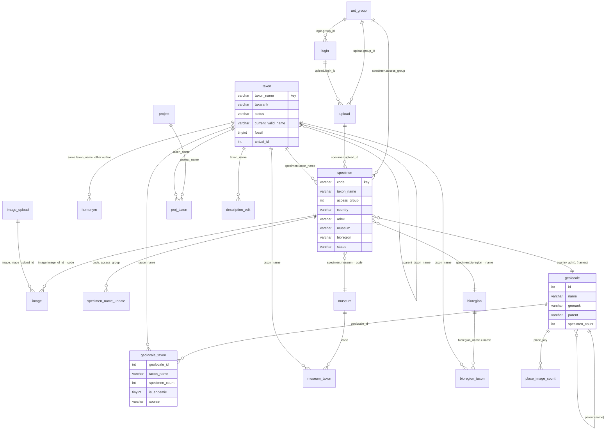

# AntWeb data model

The tables of AntWeb's MySQL database `ant`: what each one holds, which code writes it, which code and pages read it,
which numbers on the site come from it, and whether it is still in use. Written from the code on master of
2026-10-21 (road map step 3). Brian Fisher's rule for this page: every number traceable to its source, so each
table names the code that writes it and the rows of [numbers.md](numbers.md) that show it.

**How the table list was made, and how sure it is.** The repository has no full schema dump. The list comes from
`tools/datamodel/list_tables.py`, which replays every `db/upgrade/<version>/*.sql` file in version order
(CREATE, ALTER, RENAME, DROP; also views), adds the tables the Java code creates itself (`CREATE TABLE IF NOT
EXISTS` in `src/`), and takes columns of the oldest tables (created before 2010, before the upgrade scripts) from
the test schemas in `test/` and `tests/`. It finds **80 tables and 9 views**. The upgrade files are working notes
as much as scripts: some say they were never run, some mix pasted output with SQL, and some changes were made by
hand on the server. So the live database can differ, and where it is known to differ this page says so (for
example: on 2026-10-21 `museum.specimen_subfamily_dist_json` was smaller on staging than `db/upgrade/6.2`
creates it; the API reads `taxon.subfamily_count` although `db/upgrade/4.150` drops it). To compare with the
live schema, run on the production host, antweb-prod (how to log in: [runbook.md](runbook.md); read-only; after this
page is merged, so the production checkout has the script):

```
F=/root/antweb/etc/db.properties
sed -n 's/^password=//p' "$F" | docker exec -i antweb_mysql_1 sh -c 'IFS= read -r p; MYSQL_PWD="$p" exec mysql -B -N -u "$1" ant -e "SELECT c.table_name, c.column_name, c.column_type, t.table_type FROM information_schema.columns c JOIN information_schema.tables t USING (table_schema, table_name) WHERE c.table_schema = DATABASE() ORDER BY c.table_name, c.ordinal_position"' sh "$(sed -n 's/^user=//p' "$F")" > /root/live-schema.tsv
python3 /root/antweb/tools/datamodel/list_tables.py --compare /root/live-schema.tsv
```

The password goes to MySQL on standard input, so it never appears on a command line. `--compare` lists tables and
views that exist only live or only in the repository, and column differences. The first such run should be
recorded here and the sections corrected.

**Keeping this page complete.** CI (`.github/workflows/tests.yaml`, step "Data model doc has a section for every
table") runs `python3 tools/datamodel/list_tables.py --check`: it fails when a table or view that the repository's
SQL creates has no section here (a heading of the form `### ` followed by the name in backticks), when a section names a table the SQL does not know or has dropped (a dropped table goes to "Dropped already" in
section 13), or when a table has two sections.
A new table therefore needs its `db/upgrade` file (or its `CREATE TABLE IF NOT EXISTS` in the code) and a section.
`python3 tools/datamodel/list_tables.py` prints every table with its columns and the file that created it.

Contents: [1. Overview](#1-overview) · [2. Every table and its status](#2-every-table-and-its-status) ·
[3. Names and specimens](#3-names-and-specimens) · [4. Places](#4-places) ·
[5. Species lists of places](#5-species-lists-of-places) · [6. Images](#6-images) ·
[7. Page text and history](#7-page-text-and-history) · [8. Uploads, name updates and jobs](#8-uploads-name-updates-and-jobs) ·
[9. Accounts, groups and security](#9-accounts-groups-and-security) · [10. Site operation](#10-site-operation) ·
[11. Reference tables loaded once](#11-reference-tables-loaded-once) · [12. Views](#12-views) ·
[13. Obsolete and backup tables](#13-obsolete-and-backup-tables) · [14. Findings](#14-findings)

## 1. Overview

AntWeb stores **specimens** (one row per pinned or alcohol specimen, keyed by its specimen code) and **names**
(the `taxon` table: AntWeb's copy of the AntCat catalog, replaced every morning, plus morphospecies and other names
curators upload). Each specimen is filed under one name (`specimen.taxon_name`) and belongs to the curator group
that uploaded it (`specimen.access_group` = `ant_group.id`). **Images** are photographs of specimens
(`image.image_of_id` = specimen code), one row per shot (head, profile, dorsal, ventral, label, field).

Everything else is about **places**, and each kind of place has its own table and its own species list:

| Place | Table (key) | Its species list (key) | How a specimen belongs to it |
|---|---|---|---|
| country, adm1 (state/province), region, subregion; islands are countries or adm1s with `is_island = 1` | `geolocale` (`id`; `georank` says which) | `geolocale_taxon` (`geolocale_id`, `taxon_name`) | `specimen.country`, `adm1`, `island_country`; a region or subregion through its countries |
| project (curated regional lists such as Madagascar, plus `worldants`, `allantwebants`, `fossilants`) | `project` (`project_name`) | `proj_taxon` (`project_name`, `taxon_name`) | the specimens of the names on the list |
| museum (owning institution) | `museum` (`code`) | `museum_taxon` (`code`, `taxon_name`) | `specimen.museum`, set from `ownedby` by nightly set 3 |
| bioregion (Afrotropical, Malagasy, ...) | `bioregion` (`name`) | `bioregion_taxon` (`bioregion_name`, `taxon_name`) | `specimen.bioregion`, set at upload from the country (and adm1) |

The species-list tables are where most numbers on the site come from: each row is one name on one place's list, with
its counts (subfamilies, genera, species, specimens, images under it) and flags (endemic, introduced). The nightly
run rebuilds them from the specimens (sets 2 and 3), counts images (set 4), and writes the totals into the place
row (`PlaceTotals`, `PlaceImageCountDb`). The home page totals are one row of `statistics`. See
[flows/nightly.md](flows/nightly.md) for the order.

There are **no foreign keys** in the schema (none in any upgrade file): every link below is by value, mostly by
name strings. `taxon_name` is AntWeb's own lowercase key, the subfamily joined to the rest of the name (for
example `myrmicinaeadelomyrmex sc04` in `db/upgrade/6.7`); specimen codes are lowercase too (`casent0106322`). A
renamed or deleted name therefore leaves rows elsewhere pointing at nothing; the nightly run and `OrphansDb`
clean these up.



## 2. Every table and its status

Status: **in use** (the code reads and writes it); **read only** (the code reads it, nothing writes it);
**admin query only** (only a saved query of the admin Query page, `query.do`, reads it); **unused**
(nothing in `src/`, `web/`, `api/` or `bin/` that runs reads or writes it); **backup** (a copy made before a change, never
read: candidate to drop); **run-time backup** (dated copies the code makes before a bulk change). The evidence for
unused and backup is a search of the code for SQL that names the table (2026-10-21). "(2021)" in a status means the table is known to have existed in production then: it is in the list of tables converted to InnoDB on 2021-04-08 (`db/upgrade/8.56/2021-04-08.sql`), the last full list of tables in the repository.

| Table | Section | Status |
|---|---|---|
| `specimen` | [3](#specimen) | in use |
| `taxon` | [3](#taxon) | in use |
| `homonym` | [3](#homonym) | in use |
| `taxon_prop` | [3](#taxon_prop) | in use |
| `geolocale` | [4](#geolocale) | in use |
| `project` | [4](#project) | in use |
| `museum` | [4](#museum) | in use |
| `bioregion` | [4](#bioregion) | in use |
| `statistics` | [4](#statistics) | in use |
| `geolocale_taxon` | [5](#geolocale_taxon) | in use |
| `proj_taxon` | [5](#proj_taxon) | in use |
| `museum_taxon` | [5](#museum_taxon) | in use |
| `bioregion_taxon` | [5](#bioregion_taxon) | in use |
| `geolocale_taxon_dispute` | [5](#geolocale_taxon_dispute) | in use |
| `proj_taxon_dispute` | [5](#proj_taxon_dispute) | in use |
| `geolocale_taxon_log`, `geolocale_taxon_log_detail` | [5](#geolocale_taxon_log) | in use |
| `proj_taxon_log`, `proj_taxon_log_detail` | [5](#proj_taxon_log) | in use |
| `taxon_set_parked` | [5](#taxon_set_parked) | in use (2026-10-19) |
| `image` | [6](#image) | in use |
| `group_image` | [6](#group_image) | in use |
| `image_upload`, `image_uploaded` | [6](#image_upload) | in use |
| `image_upload_refused` | [6](#image_upload_refused) | in use (2026-10-18) |
| `image_like` | [6](#image_like) | in use |
| `place_image_count` | [6](#place_image_count) | in use (2026-10-20) |
| `artist` | [6](#artist) | in use |
| `copyright` | [6](#copyright) | in use |
| `license` | [6](#license) | unused |
| `artist_group` | [6](#artist_group) | unused (2021) |
| `measurement` | [6](#measurement) | in use (API only, 2026-10-07) |
| `description_edit` | [7](#description_edit) | in use |
| `description_hist` | [7](#description_hist) | in use |
| `description_homonym` | [7](#description_homonym) | in use |
| `object_edit`, `object_hist` | [7](#object_edit) | in use |
| `event` | [7](#event) | in use |
| `upload` | [8](#upload) | in use |
| `upload_line` | [8](#upload_line) | in use |
| `worldants_upload` | [8](#worldants_upload) | in use |
| `specimen_name_update` | [8](#specimen_name_update) | in use (2026-10-20) |
| `background_job` | [8](#background_job) | in use (2026-10-20) |
| `object_map` | [8](#object_map) | in use |
| `ant_group` | [9](#ant_group) | in use |
| `login` | [9](#login) | in use |
| `login_project`, `login_country` | [9](#login_project) | in use |
| `password_reset` | [9](#password_reset) | in use (2026-10-16) |
| `remember_token` | [9](#remember_token) | in use (2026-10-16) |
| `server` | [10](#server) | in use |
| `operation_lock` | [10](#operation_lock) | read only (nothing writes it) |
| `long_request` | [10](#long_request) | in use |
| `admin_alerts` | [10](#admin_alerts) | in use |
| `user_agent`, `user_agent_whitelist` | [10](#user_agent) | in use |
| `country` | [11](#country) | unused (its reader is never called) |
| `un_country` | [11](#un_country) | admin query only |
| `adm1` | [11](#adm1) | unused (its reader is never called) |
| `country_bioregion` | [11](#country_bioregion) | unused (2021) |
| `lookup` | [11](#lookup) | unused |
| `antwiki_taxon_country` | [11](#antwiki_taxon_country) | unused (reader never called) |
| `antwiki_valid_taxa`, `antwiki_fossil_taxa` | [11](#antwiki_valid_taxa) | admin query only |
| `ancillary` | [11](#ancillary) | admin query only |
| `command` | [11](#command) | unused |
| `taxon_country` | [11](#taxon_country) | unused; dropped by `db/upgrade/6.16` but still there in 2021 |
| 9 views | [12](#12-views) | `api3_1_specimen`, `taxon_image` in use (API); the other 7 unused |
| `team_member` | [13](#team_member) | unused (2021) |
| 10 backup tables | [13](#13-obsolete-and-backup-tables) | backup |
| `login_inactive_backup_*`, `description_sanitize_backup_*` | [13](#login_inactive_backup_) | run-time backup |

## 3. Names and specimens

### `specimen`

**Purpose.** One row per specimen record: a physical ant (or, for other families, insect) specimen in a collection,
as uploaded by its curator group. The center of the data model: every count of specimens on the site is a count of
these rows.

**Key.** `code`, the lowercase specimen code (e.g. `casent0106322`; primary key in `db/upgrade/4.59`). An upload
first deletes the group's specimens (`specimen.access_group`), then inserts the file's.

**Key columns.**

| Column | Meaning |
|---|---|
| `taxon_name` | the name the specimen is filed under (AntWeb key, see section 1); the current valid name when the upload or the nightly name update moved it |
| `original_taxon_name` | the name in the curator's file when it differs from `taxon_name` ("Uploaded As") |
| `status` | the status of `taxon_name` at upload: `valid`, `unrecognized`, `morphotaxon`, `indetermined`, `unidentifiable` (the five statuses counted on place pages, `PlaceImageCountDb.COUNTABLE`), or a non-valid AntCat status (`synonym`, `homonym`, ...; `Status.java`) |
| `subfamily`, `genus`, `species`, `subspecies`, `family`, `tribe`, `subgenus`, `speciesgroup`, `kingdom_name` ... `order_name` | the name parts as uploaded |
| `access_group`, `access_login`, `upload_id` | group, login and upload that loaded it (`ant_group.id`, `login.id`, `upload.upload_id`) |
| `country`, `adm1`, `adm2`, `island_country`, `region`, `subregion`, `bioregion` | place names; `region`, `subregion`, `island_country` and (if empty) `bioregion` are derived at upload from the `geolocale` row of the country (`SpecimenUploadParse`) |
| `museum` | museum code, set by nightly set 3 where the code is a whole word of `ownedby` (`MuseumDb.specimenMuseumDml`, `ownedByPattern`) |
| `ownedby`, `locatedat`, `collectedby`, `determinedby`, `collectioncode`, `localitycode`, `localityname` | as uploaded |
| `decimal_latitude`, `decimal_longitude` (float, decimal degrees), `latlonmaxerror` (text), `elevation` (int, metres), `elevationmaxerror` | coordinates and elevation as uploaded |
| `datecollectedstart`, `datecollectedend`, `datedetermined` | dates as normalised strings (varchar(20)); the `...str` columns keep the text as uploaded |
| `caste`, `subcaste`, `life_stage`, `medium`, `type_status`, `habitat`, `microhabitat`, `method` | as uploaded; `caste` is also recomputed from `life_stage` (`SpecimenDb.updateCaste`) |
| `is_introduced`, `is_endemic` | flags (0/1) |
| `image_count` | number of images of this specimen, nightly set 4 (`ImageCountDb.countSpecimenImages`) |
| `previous_determinations` | earlier identifications, newest first, separated by ` \| ` (TaxonWorks upload; `db/upgrade/8.110`) |
| `taxonworks_co_id` | TaxonWorks collection object id (CAS nightly upload) |
| `flag`, `issue` | upload checks (red flag and its reason) |
| `other` | every uploaded column AntWeb has no column for (longtext) |
| `line_num`, `backup_file_name` | where the row came from in the uploaded file |

**Written by.** The specimen upload: `AntwebUpload.saveSpecimen` after `SpecimenUploadDb.deleteSpecimens`
(curator file upload, `upload.do?action=specimenUpload`, and the nightly CAS TaxonWorks upload in set 1; see
[flows/specimen-upload.md](flows/specimen-upload.md)). The nightly name update (`SpecimenNameUpdate`, set 1)
changes `taxon_name` and `original_taxon_name`. Set 3: `museum` (`MuseumDb.populateSpecimenMuseum`). Set 4:
`image_count`. `SpecimenDb.updateCaste`, `updateSpecimenStatus`, `updateSpecimenLocalityCode`,
`updateParsedDates` (admin data jobs, `utilData.do`).

**Read by.** Nearly everything: specimen, collection and locality pages, taxon pages (`Species.setChildren`,
`Taxon`), maps (`MapLocality`), searches (`AdvancedSearch`, `GenericSearch`), downloads, the place counts
(`PlaceTotals`, `PlaceImageCountDb`, `GeolocaleTaxonDb.generateGeolocaleTaxaFromSpecimens`, `MuseumDb`,
`BioregionDb`), `CountCheck` and `CountInvariants`, the API (`/specimens`, `/geoSpecimens` through the view
[`api3_1_specimen`](#api3_1_specimen)).

**Numbers.** [numbers.md](numbers.md#2-inventory) #2, #4 (through `statistics`), #26 and #74 (Specimens of a place),
#35 (Specimens per Subfamily pie), #40, #43, #50 to #53 (habitat, microhabitat, method), #63, #64 to #72, #100.

**Status.** In use.

### `taxon`

**Purpose.** Every name AntWeb knows: AntWeb's copy of the AntCat catalog (rows with `antcat = 1`, deleted and
loaded again every morning by nightly set 1), plus names AntCat does not have that came with specimen uploads or
species lists (morphospecies such as `sp. ma01`, indeterminate names, placeholders AntWeb makes to keep the
hierarchy complete).

**Key.** `taxon_name` (AntWeb's key, section 1).

**Key columns.**

| Column | Meaning |
|---|---|
| `taxarank` | `family`, `subfamily`, `tribe`, `genus`, `subgenus`, `species`, `subspecies` (`Rank.java`) |
| `status` | `valid`, `synonym`, `homonym`, `unavailable`, `unidentifiable`, `original combination`, `obsolete combination`, `obsolete classification`, `collective group name`, `excluded from formicidae`, `unavailable misspelling`, `unavailable uncategorized` (AntCat), or AntWeb's own `unrecognized`, `morphotaxon`, `indetermined` (`Status.java`) |
| `current_valid_name`, `current_valid_rank`, `current_valid_parent` | for a non-valid name, the valid name AntCat points to |
| `antcat` (1 = from AntCat), `antcat_id` | AntCat's taxon id (https://www.antcat.org/catalog/ANTCAT_ID) |
| `fossil` | 1 = fossil |
| `parent_taxon_name`, `parent`, `family` ... `subspecies` | the hierarchy and the name parts |
| `author_date`, `author_date_html`, `authors`, `year`, `available`, `original_combination`, `was_original_combination` | nomenclature from AntCat |
| `source`, `insert_method` | which load made the row (e.g. a species list file, `addMissingGenus`, `homononymMirroringTaxon`) |
| `access_group` | the group whose upload made a non-AntCat name |
| `image_count` | images of the taxon's specimens and of the taxa under it, set 4 (`ImageCountDb.updateTaxonImageCount`) |
| `type` | 1 = a species (not a morphospecies) with at least one specimen with a type status, set 3 (`TaxonDb.crawlForType`) |
| `chart_color` | the subfamily's colour in pie charts, set 1 (`TaxonDb.setSubfamilyChartColor`) |
| `bioregion`, `country` | AntCat's distribution text, as exported |

**Written by.** Set 1, AntCat import (`SpeciesListUploader.worldantsFetchAndReload`, `SpeciesListUploadDb.prepareDatabase`
deletes `antcat = 1` rows; see [flows/antcat-to-antweb.md](flows/antcat-to-antweb.md) section 3). Specimen uploads
add names (`SpecimenUploadProcess.processLine`, `UploadDb.insertGenus`, `insertSubfamily`) and delete orphans
(`SpecimenUploadDb.deleteTaxonOrphans`). Set 2 deletes species and genera without specimens or AntCat source
(`TaxonDb.deleteSpeciesWithoutSpecimenOrAntcatSource`). Admin tools: `TaxonDb.renameTaxon`, `combineTaxa`,
`deleteTaxon`, `OrphansDb`.

**Read by.** Every taxon page and list (cached in memory by `TaxonMgr`), all place counts (they join list rows to
`taxon` for rank, status and family), the API `/taxa` (`api.py`, class with `__tablename__ = 'taxon'`).

**Numbers.** #1, #3 (through `statistics`), #6 (`TaxonMgr.getValidSpeciesCount`), #11 and #12 (Global Data), #54,
#56, #61, #103, #104.

**Status.** In use. Note: the API maps `subfamily_count`, `genus_count`, `species_count`, `specimen_count` of this
table (#103, "taxon columns that no current code writes"); `db/upgrade/4.150/2013-06-19.sql` adds and then drops
them, so whether they exist live, and with what values, needs the `--compare` run.

### `homonym`

**Purpose.** AntCat names that are homonyms of a name in `taxon` (the same `taxon_name` string for a different
taxon, e.g. a junior homonym with another author). `taxon` can hold only one row per name string; the others are
kept here.

**Key columns.** As `taxon` (the table was created from it, `db/upgrade/5.15`), plus count columns.

**Written by.** Set 1 AntCat import (`SpeciesListUploadDb.prepareDatabase` deletes `antcat = 1` rows; the import
inserts them), `WorldantsUploadDb.deleteHomonymsWithoutTaxa`, `TaxonDb.fixHtmlAuthorDates`.

**Read by.** Homonym pages (`Homonym`, `description.do` for a homonym), `HomonymDb`, the upload's name rule
(`CurrentValidNameRule`, `SharedNames.fromHomonymTable`), admin queries.

**Numbers.** None directly.

**Status.** In use.

### `taxon_prop`

**Purpose.** Properties of a taxon chosen by curators: the default specimen whose images represent the taxon
(`prop` ending in `Specimen`), the bioregion map and the introduced-species map.

**Key columns.** `taxon_name`, `prop` (property name), `value`, `login_id` (who set it), `created`.

**Written by.** `ImagePickDb.setDefaultSpecimen` (`defaultSpecimen.do`), `TaxonPropDb.updateMapProp`
(Bioregion and Introduced Map managers), set 5 `TaxonPropDb.deleteConflictedDefaultImages`, `OrphansDb.deleteTaxon`.

**Read by.** Taxon pages (default images), `BioregionMapMgrAction`, `IntroducedMapMgrAction`, `TaxonPropMgr`.

**Numbers.** None.

**Status.** In use.

## 4. Places

### `geolocale`

**Purpose.** Countries, first-level divisions (adm1: states, provinces, regions of Madagascar), UN regions and
subregions: the geographic places of the site (`country.do`, `adm1.do`, `region.do`, `subregion.do`, and the island
pages).

**Key.** `id`. `name` is unique within its parent.

**Key columns.**

| Column | Meaning |
|---|---|
| `georank` | `region`, `subregion`, `country`, `adm1` (`adm2` exists in `Georank.java`) |
| `parent` | name of the place above (a country's subregion, an adm1's country) |
| `region`, `subregion` | the UN region and subregion of a country |
| `is_valid` | 1 = a real current place (0 = an alias or misspelling; `valid_name` then names the valid place) |
| `is_live` | 1 = shown on the site |
| `is_island` | 1 = also an island page (specimens matched by `specimen.island_country`) |
| `is_un` | 1 = a UN member country |
| `is_use_children`, `is_use_parent_region` | how a country's map and region are chosen |
| `bioregion`, `alt_bioregion` | the bioregion of the place (used at upload to set `specimen.bioregion`) |
| `iso3code`, `isocode` | ISO 3166 codes |
| `centroid`, `bounding_box` (and `_fixed`, a manual override), `extent`, `coords`, `map` | map data |
| `source`, `rev` | where the place came from (`Geonames`, `Flickr`, ...), revision |
| `subfamily_count`, `genus_count`, `species_count`, `valid_species_count` | counted from the place's list (`PlaceTotals.writeListedCounts`, set 2) |
| `specimen_count` | Specimens: the specimens of the species and subspecies rows of the list, counted status, ants only (set 2) |
| `endemic_species_count`, `introduced_species_count` | rows flagged on the list |
| `image_count`, `imaged_specimen_count` | all image files; specimens with an image of the ant, set 4 (`PlaceImageCountDb`) |
| `taxon_subfamily_dist_json`, `specimen_subfamily_dist_json` | the two pie charts (JSON, varchar(5000) per `db/upgrade/6.3`), written by `PlaceTotals.writePies` |
| `chart_color` | the place's colour in the pies of a list of places |
| `admin_notes` | notes for admins |
| `specimen_local_count` | not named in any SQL of the code (see section 14) |

**Written by.** The Geolocale manager (`editGeolocale.do`: `GeolocaleDb.createGeolocale`, `updateGeolocale`,
`deleteGeolocale`; see [guides/manager-tools.md](guides/manager-tools.md)); specimen uploads add adm1s
(`GeolocaleDb.addAdm1FromSpecimenData`); set 2 (`GeolocaleDb.updateCounts`, `PlaceTotals`); set 4
(`PlaceImageCountDb.updateAll`); the Recalculate button of a place page (`updatePlace`); `updateColor`.

**Read by.** All place pages and lists of places (cached by `GeolocaleMgr`), the upload (country and adm1 checks),
the API `/geolocales`, `CountCheck`, `CountInvariants`.

**Numbers.** #20 to #37 (place pages), #73 to #77 (lists of places), #108 to #111 (API).

**Status.** In use.

### `project`

**Purpose.** Projects: curated species lists with their own page, most of them regional (e.g. Madagascar,
Bay Area), plus the site-wide lists `worldants` (every AntCat name), `allantwebants` (every name with a specimen,
the Global column) and `fossilants`.

**Key.** `project_name`.

**Key columns.** `project_title`, `root`, `scope` (`PROJECT` or `GLOBAL`), `is_live`, `species_list_mappable`,
`display_key`, `source`, `specimenimage1` to `3` and `authorimage` (page images), `coords`, the same count and pie
columns as `geolocale`.

**Written by.** The Project manager (`ProjectDb.save`, `update`), set 3 (`ProjectDb.updateCounts`, `PlaceTotals`),
set 4 (`PlaceImageCountDb`), `SpeciesListUploadDb.updateProjectUploadDate`.

**Read by.** Project pages and lists (cached by `ProjectMgr`), `CountCheck`, `CountInvariants`.

**Numbers.** #20 to #37, #73 to #77.

**Status.** In use. The `project` table has no CREATE in the repository (it predates the upgrade scripts).

### `museum`

**Purpose.** Institutions that own specimens (CASC, MCZC, ...): the museum pages.

**Key.** `code` (the institution code that appears in `specimen.ownedby`).

**Key columns.** `name`, `title`, `active`, and the count and pie columns as `geolocale`.

**Written by.** The Museum manager (`MuseumDb.saveMuseum`, `deleteByCode`), set 3 (`MuseumDb.populate`,
`PlaceTotals`), set 4 (`PlaceImageCountDb`), and after each specimen upload (`SpecimenUpload.importSpecimens`).

**Read by.** Museum pages (`museum.do`, `museums.do`), `CountInvariants`.

**Numbers.** #18, #19 (statsPage Museum Data, through `museum_taxon`), #20 to #37, #73 to #77.

**Status.** In use. **Live schema differs:** `db/upgrade/6.2` creates the two pie columns as varchar(10000); on
staging they are smaller (evidently varchar(1000), commit d5520415 of 2026-10-21, after an upload rolled back with
"Data too long for column specimen_subfamily_dist_json"). The code now fits the JSON to the column's size; the
optional `db/upgrade/8.114/2026-10-21-museum-chart-columns.sql` widens them to varchar(5000) like the other places.

### `bioregion`

**Purpose.** The biogeographic regions (Afrotropical, Malagasy, Neotropical, ...): the bioregion pages.

**Key.** `name`.

**Key columns.** `title`, `description`, `extent`, `locality`, and the count and pie columns as `geolocale`.

**Written by.** Set 3 (`BioregionDb.populate`, `calcEndemic`, `calcIntroduced`, `PlaceTotals`), set 4
(`PlaceImageCountDb`), `updateColor`.

**Read by.** Bioregion pages, the API `/bioregions`, `CountInvariants`.

**Numbers.** #17 (statsPage, through `bioregion_taxon`), #20 to #37, #73 to #77, #114, #115.

**Status.** In use.

### `statistics`

**Purpose.** Site totals over time: one row each time they are computed. The home page and `statsPage.do` show the
latest row; the admin page `statistics.do` shows the history.

**Key columns.** `id`, `created`, `action` (what triggered it), `login_id`, `exec_time`, and the totals:
`specimens`, `specimens_imaged`, `total_images`, `species_imaged`, `valid_species_imaged`, `extant_taxa`,
`total_taxa`, `proj_taxa`, `geolocale_taxa`, `geolocale_taxa_endemic`, `geolocale_taxa_introduced`,
`bioregion_taxa`, `museum_taxa`.

**Written by.** `StatisticsDb.populateStatistics`: after each specimen upload (`UploadAction`) and, since
2026-10-21, every night in set 4 (`UtilDataAction`).

**Read by.** `AntwebMgr.populateStats` (home page, `genInc/statistics.jsp`), `StatisticsAction` (`statistics.do`),
`CountInvariants` (check `home`).

**Numbers.** #1 to #5, #7 to #10, #97.

**Status.** In use.

## 5. Species lists of places

The four list tables have the same shape: one row per name on one place's list, with counts of what is under that
name at that place (`subfamily_count`, `genus_count`, `species_count`, `specimen_count`, `image_count`), and
`source` (where the row came from: `specimen`, `antcat`, `curator`, `speciesListTool`, `worldants`, ...).
`bin/taxonSetBackup.sh` dumps all four weekly to `/mnt/antweb/web/bak/taxonSets/`.

### `geolocale_taxon`

**Purpose.** The species list of each country, adm1, region and subregion.

**Key.** (`geolocale_id`, `taxon_name`), unique (`db/upgrade/7.9`).

**Key columns.** The counts above; `is_endemic`, `is_introduced` (0/1); `source`; `rev`; `insert_method`;
`created`, `modified`; `specimen_local_count` (not named in any SQL of the code).

**Written by.** Set 2: `GeolocaleTaxonDb.generateGeolocaleTaxaFromSpecimens` (deletes and re-inserts the
specimen-derived rows), `GeolocaleTaxonCountDb.childrenCountCrawl`, `calcEndemic`; set 1: AntCat rows
(`SpeciesListUploadDb.prepareDatabase`); set 3: names moved to the current valid name
(`TaxonSetDb.updateTaxonSetTaxonNames`); set 4: `image_count`; curators' species list tool (`SpeciesListDb`,
`GeolocaleTaxonDb.insertItem`, `deleteItem`).

**Read by.** Country, adm1, region and subregion taxon lists and pages, endemic and introduced pages
(`EndemicAction`, `IntroducedAction`), `PlaceTotals`, `CountCheck`, `CountInvariants`, the API `/geolocaleTaxa`,
`/unimagedGeolocaleTaxa`.

**Numbers.** #20 to #25, #34, #40 to #42, #44, #48, #78, #79, #112, #113, #117, #118.

**Status.** In use.

### `proj_taxon`

**Purpose.** The species list of each project, including the three site-wide lists (`worldants`, `allantwebants`,
`fossilants`, see [`project`](#project)).

**Key.** (`project_name`, `taxon_name`).

**Key columns.** The counts above; `is_endemic`; `source`; `rev`; `created`.

**Written by.** Set 1 (`worldants` replaced, `allantwebants` regenerated: `ProjTaxonDb.regenerateAllAntweb`), every
specimen upload (`allantwebants`), set 3 (`ProjTaxonCountDb.curatedProjectsCountCrawl`, names moved), set 4
(`image_count`), set 5 (`cleanupSpeciesListProxyRecords`, `verifyProjTaxon`), curators' species list tool and
species list upload (`ProjTaxonDb.insertItem`, `delete`).

**Read by.** Project pages and lists, the Global column of every taxon list (`allantwebants`), `Project` counts,
`PlaceTotals`, `CountInvariants`, admin queries.

**Numbers.** #20 to #22, #26, #34, #35, #40 to #44, #48.

**Status.** In use. No CREATE in the repository (predates the upgrade scripts).

### `museum_taxon`

**Purpose.** The species list of each museum: the names of its specimens and their higher taxa.

**Key.** (`code`, `taxon_name`).

**Written by.** Set 3 (`MuseumDb.populate`: delete the museum's rows, `insertSpecies`, `insertTaxon`,
`populateHigherTaxa`, counts), set 4 (`image_count`), `OrphansDb.deleteTaxon`.

**Read by.** Museum taxon lists, `StatisticsDb` (statsPage Museum Data), `MuseumTaxonDb.getStatisticsByMuseum`,
`PlaceTotals`.

**Numbers.** #18, #19, #20 to #22, #40 to #42, #44.

**Status.** In use.

### `bioregion_taxon`

**Purpose.** The species list of each bioregion.

**Key.** (`bioregion_name`, `taxon_name`).

**Key columns.** The counts above; `is_endemic`, `is_introduced`; `source`; `insert_method`.

**Written by.** Set 1 (AntCat bioregion rows), set 3 (`BioregionDb.populate`, `BioregionTaxonDb.insertSpecies`,
`insertTaxon`, `calcEndemic`), set 4 (`image_count`), `OrphansDb.deleteTaxon`.

**Read by.** Bioregion taxon lists, endemic and introduced pages, `StatisticsDb` (statsPage Bioregion Data), the API
`/bioregionTaxa`.

**Numbers.** #17, #20 to #25, #40 to #42, #44, #78, #79, #116, #118.

**Status.** In use.

### `geolocale_taxon_dispute`

**Purpose.** Names a curator removed from a country's or adm1's list although specimens put them there: the nightly
rebuild (set 2) removes them again (`generateGeolocaleTaxaFromSpecimens`).

**Key columns.** `geolocale_id`, `taxon_name`, `source`, `rev`, `curator_id`, `created`.

**Written by.** `GeolocaleTaxonLogDb.insertDispute`, `removeDispute` (curators' species list tool, `SpeciesListDb`).

**Read by.** `GeolocaleTaxonLogDb.getDispute(s)`, set 2, admin query.

**Numbers.** Indirectly #20 to #26 (rows it removes are not counted).

**Status.** In use.

### `proj_taxon_dispute`

**Purpose.** The same for project lists.

**Key columns.** `project_name`, `taxon_name`, `source`, `rev`, `curator_id`, `created`.

**Written by.** `ProjTaxonLogDb.insertDispute`, `removeDispute`. **Read by.** `ProjTaxonLogDb`,
`ProjTaxonDb.regenerateAllAntweb`, admin query.

**Status.** In use.

### `geolocale_taxon_log`

**Purpose.** History of curators' edits of a geolocale list: `geolocale_taxon_log` has one row per saved
version (`log_id`, `geolocale_id`, `curator_id`, `created`, `is_current`), `geolocale_taxon_log_detail` (heading
below) the rows of the list at that version.

**Written by.** `GeolocaleTaxonLogDb.archiveSpeciesList` (each save of the species list tool).

**Read by.** The curation history pages (`GeolocaleTaxonLogDb.getGeolocaleTaxonLogs`, `getCurations`,
`getCuratorLogins`).

**Status.** In use.

### `geolocale_taxon_log_detail`

The rows of a geolocale list at one saved version: `log_id`, `geolocale_id`, `taxon_name` and the count columns.
Written and read with [`geolocale_taxon_log`](#geolocale_taxon_log). In use.

### `proj_taxon_log`

History of curators' edits of project lists, as [`geolocale_taxon_log`](#geolocale_taxon_log): `log_id`,
`project_name`, `curator_id`, `created`, `is_current`. Written by `ProjTaxonLogDb.archiveSpeciesList`, read by
`ProjTaxonLogDb.getProjTaxonLogs`, `getCuratorLogins`. In use.

### `proj_taxon_log_detail`

The rows of a project list at one saved version. Written and read by `ProjTaxonLogDb`. In use.

### `taxon_set_parked`

**Purpose.** A curator's row of a geolocale or project list whose name disappeared from `taxon` when a cleanup ran
(set 2 `dataCleanup`, an upload's orphan step). The row is kept here and put back when the name exists again
(Brian, 2026-10-19).

**Key columns.** `list_type` (`geolocale` or `project`), `list_key` (geolocale id or project name), `taxon_name`,
`source`, `created`, `parked`, `restored` (when it was put back; NULL = still waiting).

**Written by.** `CuratorTaxonSetDb` (park, `restore` at the start of set 2 and `utilData.do?action=restoreParkedTaxonSets`),
`SpecimenNameUpdate` (moves parked entries with a renamed name). Created by the application
(`CuratorTaxonSetDb.ensureSchema`); record and undo in `db/upgrade/8.113/2026-10-19-taxon-set-parked.sql`.

**Read by.** The same classes.

**Status.** In use.

## 6. Images

### `image`

**Purpose.** One row per image file of a specimen (the files are under `/mnt/antweb/images/<code>/` and served from
static.antweb.org).

**Key.** `id` (was `uid`, renamed in `db/upgrade/8.0`).

**Key columns.** `image_of_id` (the specimen code), `source_table` (`specimen`), `shot_type` (`h` head, `p`
profile, `d` dorsal, `v` ventral, `l` label, `f` field; `PlaceImageCountDb`), `shot_number`, `artist`
(`artist.id`), `copyright` (`copyright.id`), `license`, `upload_date`, `has_tiff`, `image_upload_id`, `modified`.

**Written by.** The Image Uploader (`ImageDb.insertImage`, one row per saved file, with its `group_image` row; see
[flows/image-upload.md](flows/image-upload.md)), `ImageDb.deleteImage`, `updateHasTif`, `ArtistDb.moveToArtist`.

**Read by.** Specimen and taxon pages (`Specimen.setImages`), image searches, the counts of set 4
(`ImageCountDb`, `PlaceImageCountDb`), `CountCheck`, `CountInvariants`, statsPage image tables
(`ImageDb.getImageStats`), the API `/images`.

**Numbers.** #3 to #5, #13 to #16, #27 to #33, #54 to #58, #61 to #64, #99, #104, #106, #107, #117.

**Status.** In use. No CREATE in the repository (predates the upgrade scripts); the columns above are from the code
and a 2018 listing pasted in `db/upgrade/7.9/2018-01-11.sql`.

### `group_image`

**Purpose.** Which curator group uploaded each image (`group_id`, `image_id`).

**Written by.** `ImageDb.insertImage`, `deleteImage`. **Read by.** `ImageDb.getSpecimenImageWithClause`,
`getImageGroupIds`, recent-image search (`GenericSearch`), admin query.

**Status.** In use. No CREATE in the repository.

### `image_upload`

**Purpose.** One row per Image Uploader session (a batch of files): `group_id`, `curator_id`, `artist_id`,
`copyright_year`, `license`, `image_count`, `complete`, `created`. Its files are in `image_uploaded`: one row per
file (`image_upload_id`, `filename`, `code`, `shot`, `number`, `ext`, `reuploaded`, `error_message`).

**Written by.** `ImageUploadDb.saveImageUpload`, `saveImageUploaded`, `completeImageUpload`, `markUploadedDone`,
`updateImageCount` (`imageUploadBatch.do`).

**Read by.** The upload report (`imageUploadReport.do`), `listImageUploads`, curator counts (`LoginDb`).

**Numbers.** #84, #93, #94.

**Status.** In use.

### `image_uploaded`

The files of an image upload, see [`image_upload`](#image_upload). In use.

### `image_upload_refused`

**Purpose.** Files of an image upload that were not saved, and why: `image_upload_id`, `filename`, `reason`,
`source` (`server` or `browser`), `created` (Brian, 2026-10-18). Shown under "Not saved" in the upload report and
counted in the upload-complete email.

**Written by.** `ImageUploadRefusedDb.record`. **Read by.** `ImageUploadRefusedDb`, `ImageUploadReport`,
`LoginMgr`. Created by the application; record in `db/upgrade/8.111`.

**Numbers.** #94.

**Status.** In use.

### `image_like`

**Purpose.** "Likes" of an image by a logged-in user: `image_id`, `login_id`, `group_id`, `created`.

**Written by.** `PictureLikeAction.likeSpecimenImage`. **Read by.** `ImageDb.getLikesLinkList`.

**Status.** In use.

### `place_image_count`

**Purpose.** The image numbers of every place, by shot type (Brian, 2026-10-20). One row per place and shot type,
plus three summary rows: `*all` (all files; specimens with any image), `*ant` (images that are not labels;
specimens with at least one: "Imaged specimens"), `*label_only` (specimens whose only images are labels).

**Key.** (`place_type`, `place_key`, `shot_type`). `place_type`: `geolocale`, `project`, `museum`, `bioregion`;
`place_key`: the place's key (geolocale id, project name, museum code, bioregion name).

**Key columns.** `image_count` (images of that shot type), `specimen_count` (specimens with at least one),
`computed`.

**Written by.** Set 4 (`PlaceImageCountDb.updateAll`), the Recalculate button (`updatePlace`). The rule for which
specimens belong to a place is the same as for the place's Specimens number (class comment of `PlaceImageCountDb`).
Created by the application; record and undo in `db/upgrade/8.113/2026-10-20-place-image-count.sql`.

**Read by.** Place pages (`PlaceImageCountDb.read`), `CountInvariants` (`place.images`).

**Numbers.** #27 to #32, #75, #76, #109.

**Status.** In use.

### `artist`

**Purpose.** Photographers credited on images (`image.artist`): `id`, `name`, `active`, `curator_id`, `created`.

**Written by.** The Photographers manager (`ArtistDb.createArtist`, `saveArtist`, `deleteArtist`). **Read by.**
`ArtistMgr`, image pages, `artists.do`.

**Numbers.** #92.

**Status.** In use. No CREATE in the repository.

### `copyright`

**Purpose.** Copyright holders and years for images (`image.copyright`): `id`, `year`, and the holder text.

**Written by.** `CopyrightDb.newCopyright` (called by `CopyrightDb` when an image upload needs a year not yet in the table). **Read by.**
`CopyrightDb.getCopyrights` (Image Uploader).

**Status.** In use. No CREATE in the repository.

### `license`

**Purpose.** Image licences (renamed column `uid` to `id` in `db/upgrade/8.0`). No SQL in the code reads or writes
it; `image.license` is written as the constant 1 (`ImageDb.insertImage`) and the licence text is in the JSPs.

**Status.** Unused by the code. Candidate to drop after checking that `image.license` = 1 means the same licence
everywhere.

### `artist_group`

**Purpose.** Old link between photographers and groups (`db/upgrade/4.57` deletes rows from it). In the 2021
table list. No SQL in the code.

**Status.** Unused. Candidate to drop.

### `measurement`

**Purpose.** Ant body-size measurements from the myrmetrics dataset (Zhao, Boyko et al.): one row per image, trait
and data release, with the keypoints, scale and quality flags of the machine measurement
(`db/upgrade/8.106/2026-10-07.sql` describes every column). `value` is in `unit` (mm); `value_px` in pixels;
`px_per_mm` and `scale_*` give the scale used.

**Written by.** `api/v3.1/load_measurements.py` (run by hand per data release). **Read by.** The API
`/v3.1/measurements` (`api.py`), which joins `specimen_code` to the specimen through
[`api3_1_specimen`](#api3_1_specimen).

**Numbers.** None in numbers.md yet.

**Status.** In use (API only).

## 7. Page text and history

### `description_edit`

**Purpose.** The text sections of taxon pages and specimen pages, one row per taxon (or specimen `code`) and
section `title` (for example `taxonomichistory`, the AntCat history loaded every night; other titles are
curators' texts such as biology or identification). `content` is HTML.

**Key columns.** `taxon_name` or `code`, `title`, `content`, `is_manual_entry`, `access_group`, `access_login`
(who wrote it), `created`, `edit_id`.

**Written by.** Curators on the description page (`DescriptionAction.writeField`), set 1 (all
`taxonomichistory` rows deleted and re-inserted, `UploadDb` / `SpeciesListUploadDb.prepareDatabase`), the admin
sanitizer (`SanitizeDescriptionsAction`), renames (`TaxonDb.renameTaxon`).

**Read by.** Taxon and specimen pages (`DescEditDb`, `Specimen.setDescription`), recent edits
(`AntwebFunctions.genRecentDescEdits`), curator counts (`LoginDb.setDescEditCounts`), `SpecimenNameUpdate`
(reasons from the AntCat history), `OrphansDb`.

**Numbers.** #81 (Description Edits of a curator).

**Status.** In use.

### `description_hist`

**Purpose.** Earlier versions of `description_edit` rows: each save copies the old version here first.

**Written by.** `DescriptionAction.writeField` (the history table of the save). **Read by.** The edit history of a
page (`DescriptionAction.getDescEditHistory`, `DescHistory`), `LoginDb.setDescEditCounts`.

**Status.** In use.

### `description_homonym`

**Purpose.** The text sections of homonyms (as `description_edit`, with `author_date` to tell the homonyms apart).

**Written by.** Set 1 (taxonomic history of homonyms), `SanitizeDescriptionsAction`. **Read by.**
`Homonym.setDescription`.

**Status.** In use.

### `object_edit`

**Purpose.** The text sections of place, project and museum pages: `object_key` (the place), `title` (the section),
`content`, `access_login`, `created`. `object_hist` (heading below) keeps the earlier versions.

**Written by.** `DescriptionAction.writeField` (place pages), `PageTextKeys` (moves the text when a place is
renamed), `SanitizeDescriptionsAction`. **Read by.** `DescEditDb.readFieldForEdit`, `getDescription`.

**Status.** In use.

### `object_hist`

Earlier versions of `object_edit` rows. Written by `DescriptionAction.writeField` and moved by `PageTextKeys`; read
by `DescHistory`. In use.

### `event`

**Purpose.** A log of curator events (`name`, `operation`, `curator_id`, `created`), written when a description is
saved (`DescriptionAction` -> `EventDb.addEvent`) and listed on the admin Query page (`QueryAction` ->
`EventDb.getEvents`).

**Status.** In use.

## 8. Uploads, name updates and jobs

### `upload`

**Purpose.** One row per specimen upload (curator file or TaxonWorks): who, which group, the report file and the
counts of what was loaded.

**Key columns.** `upload_id` (the number written into `specimen.upload_id`; `id` is the row id), `login_id`,
`group_id`, `group_name`, `log_file_name` (the upload report), `backup_dir_file`, `specimens`, `subfamilies`,
`genera`, `species`, `collections`, `localities`, `ungeoreferenced`, `flagged`, `created`.

**Written by.** `SpecimenUploadDb.updateUpload`, `UploadDb.updateCounts` (end of each upload, `UploadAction`,
`SpecimenUploadJob`). **Read by.** `listSpecimenUploads`, group and curator pages (`GroupDb`, `LoginDb.setUploadCounts`),
`UploadMgr`, `CountCheck`, `CountInvariants`, `logMgr.do`, `tools/staging/refresh-from-prod.sh`.

**Numbers.** #80, #82, #83, #85 to #91. Note B14 in numbers.md: `species` counts distinct epithets, not names.

**Status.** In use.

### `upload_line`

**Purpose.** The lines of a group's last uploaded specimen file (`file_name`, `line_num`, `display_line_num`, `line`,
`group_id`), so the upload report can show a line by number.

**Written by.** `UploadDb.removeUploadLines`, `addUploadLine` (`LineNumMgr`, at each upload). **Read by.**
`UploadDb.getUploadLine`.

**Status.** In use.

### `worldants_upload`

**Purpose.** One row per AntCat import (set 1): `operation`, `validate_message`, `file_size`,
`orig_worldants_count`, `backup_file_name`, `log_file_name`, `exec_time`, `created`.

**Written by.** `WorldantsUploadDb.insertWorldantsUpload`, `updateWorldantsUpload`. **Read by.** The admin query
`worldantsUploads` (`query.do`), `WorldantsUploadDb.getWorldantsChangeCount` (the size guard).

**Status.** In use.

### `specimen_name_update`

**Purpose.** The record of the nightly name update (Brian, 2026-10-18): one row per specimen it moved to another
name (`mode = 'changed'`) or would move (`would_change`).

**Key columns.** `run_date`, `mode`, `code`, `access_group`, `uploaded_name`, `old_name`, `new_name`,
`antcat_status`, `reason` (from AntCat's taxonomic history, with the reference), `antcat_id`.

**Written by.** `SpecimenNameUpdateDb.insert` (set 1, `SpecimenNameUpdate.runLocked`; "Preview now" on
`nameUpdates.do`). Created by the application; record and undo in
`db/upgrade/8.113/2026-10-20-specimen-name-update.sql`.

**Read by.** `nameUpdates.do` (`SpecimenNameUpdateDb.getLines`, `getRuns`), the specimen page's Name History
(`SpecimenNameHistory`), `CountCheck`.

**Status.** In use.

### `background_job`

**Purpose.** Uploads and admin data jobs run in the background with a status page (`jobStatus.do`): one row per job
(Brian, 2026-10-20).

**Key columns.** `kind` (`upload` or `data`), `action`, `title`, `login_id`, `login_name`, `group_id`, `status`
(`queued`, `running`, `finished`, `failed`, `interrupted`), `step`, `result`, `result_link`, `created`, `started`,
`finished`.

**Written by.** `BackgroundJobDb` (via `BackgroundJobs`; the SQL names the table through the constant
`BackgroundJobDb.TABLE`). **Read by.** `jobStatus.do`, the Curate page, `countCheck.do?job=N`. Created by the
application; record in `db/upgrade/8.113/2026-10-20-background-job.sql`.

**Status.** In use.

### `object_map`

**Purpose.** Pre-computed map data (the Google map function text) of a country, adm1, museum, group or taxon:
`geolocale_id`, `museum_code`, `group_id`, `taxon_name`, `google_map_function`, `title`, `subtitle`, `info`.

**Written by.** Set 5 (`ObjectMapDb.genObjectMaps`), uploads (the group's map), `UtilDataAction`. **Read by.** Map
pages (`ObjectMapDb.getMap`: `BigMapAction`, `OverviewAction`, `AdvancedSearchAction`).

**Status.** In use. On staging set 5 is skipped, so staging maps can be older than production's.

## 9. Accounts, groups and security

### `ant_group`

**Purpose.** Curator groups (institutions or teams that upload specimens and images). Renamed from `groups` in
`db/upgrade/8.0/2020-02-12.sql`.

**Key columns.** `id`, `name`, `abbrev`, `admin_login_id`, `upload_specimens`, `first_specimen_upload`,
`last_specimen_upload`, `upload_count`.

**Written by.** The Groups manager (`GroupDb.saveGroup`, `updateGroup`, `deleteById`), uploads
(`SpecimenUploadDb.updateSpecimenUploadDate`, `UploadDb.updateGroup`), `UploaderOnboarding`.

**Read by.** Group pages (`groups.do`, `group.do`), searches and admin queries that show the group name, the upload.

**Numbers.** #85.

**Status.** In use. No CREATE in the repository.

### `login`

**Purpose.** User accounts (curators, admins, uploaders).

**Key columns.** `id`, `name` (login name), `email`, `first_name`, `last_name`, `password` (a
`pbkdf2_sha256$iterations$salt$hash` string since `db/upgrade/8.107`, 2026-10-14; never plain text), `group_id`,
`is_admin`, `is_upload_specimens`, `is_upload_images`, `last_login`, `created`, `session_version` (raised to end
all sessions), `must_reset`, `inactive`, `inactive_since` (`db/upgrade/8.112`).

**Written by.** `LoginDb.saveLogin`, `updateLogin`, `updateLastLogin`, `changePassword`, `PasswordResetDb`,
`InactiveAccountDb`, `UploaderOnboarding`, `EditLoginAction`, `LoginEdit`. **Read by.** Login, curator pages
(`curators.do`), `LoginMgr`, `RememberMeMgr`.

**Numbers.** #80 to #84 (counts kept per login, computed at startup from `upload`, `image_upload`,
`description_edit`, `description_hist`).

**Status.** In use. Staging's copy is scrubbed after each refresh (`tools/staging/scrub.sql`).

### `login_project`

**Purpose.** Which projects (`login_project`: `login_id`, `project_name`) and countries (`login_country`, heading
below: `login_id`, `country`) a curator may edit the species lists of.

**Written by.** `LoginDb.updateLoginProjects`, `updateLoginCountries`, `ProjectDb.updateProjects`. **Read by.**
`LoginEdit`, `InactiveAccountDb`, `PasswordResetDb.getCampaignAccounts`.

**Status.** In use.

### `login_country`

Countries a curator may edit, see [`login_project`](#login_project). In use.

### `password_reset`

**Purpose.** One row per emailed password reset (or reactivation) link: `login_id`, `token_hash` (SHA-256 of the
token; the token itself is never stored), `created`, `expires`, `used_at`, `requested_ip`.

**Written by.** `PasswordResetDb.insertToken`, `consumeToken`, `invalidateOutstanding`. **Read by.**
`PasswordResetDb` (rate limits, `findValidLoginId`). Created by the application; record in `db/upgrade/8.108`.
Emptied on staging by `scrub.sql`.

**Status.** In use.

### `remember_token`

**Purpose.** "Keep me logged in": one row per remembered browser (`login_id`, `selector`, `token_hash`,
`prev_hash`, `rotated`, `session_version`, `user_agent`, `created`, `last_used`, `expires`).

**Written by.** `RememberTokenDb` (insert, rotate, delete), `InactiveAccountDb`. **Read by.**
`RememberTokenDb.findBySelector`. Created by the application; record in `db/upgrade/8.109`.

**Status.** In use.

## 10. Site operation

### `server`

**Purpose.** One row of server switches: `is_down_time` (the site shows a downtime notice), `debug`.

**Written by.** `ServerDb.toggleDownTime`, `setServerDebug` (`serverStatus.do`). **Read by.** `ServerDb`,
`SessionRequestFilter`, `ServerStatusAction`, `WorldantsUploadDb`.

**Status.** In use.

### `operation_lock`

**Purpose.** An old lock that kept two long operations from running together (`operation`, `locked`, `curator`,
`curator_id`, `duration_millis`, `unlock_op`).

**Written by.** Nothing that runs: `OperationLockDb.setOperationLock`, `unlock`, `enable` and `disable` have no
callers. **Read by.** `ServerStatusAction` (shown on the server status page).

**Status.** Read only; nothing sets the lock any more (uploads use the upload flag and `BackgroundJobs`). Candidate
to drop with `OperationLockDb` and the status page line.

### `long_request`

**Purpose.** Requests that took long, and the cache of slow pages (`url`, `dir_file`, `millis`, `cache_type`,
`cached`, `is_bot`, `is_logged_in`, `busy_connections`, `request_info`).

**Written by.** `AntwebCacheMgr` (`insertLongRequest`, `reCacheItem`, `deleteOldLongRequests`, ...). **Read by.**
`AntwebCacheMgr` (browse, description, field guide and taxa pages).

**Status.** In use.

### `admin_alerts`

**Purpose.** Messages for admins shown on admin pages until acknowledged (`alert`, `acknowledged`, `created`).

**Written by.** `AdminAlertMgr.add`, `remove`, `removeAll`. **Read by.** `AdminAlertMgr.loadAlerts`, admin query.

**Status.** In use.

### `user_agent`

**Purpose.** User agents (browsers and bots) seen by the site (`user_agent`: `name`, `created`) and the allowed
ones (`user_agent_whitelist`, heading below).

**Written by.** `UserAgentDb.saveAgent` (`SessionRequestFilter`). **Read by.** `UserAgentDb.getKnownAgents`,
`flagWhiteList`.

**Status.** In use.

### `user_agent_whitelist`

User agents marked as allowed, see [`user_agent`](#user_agent). Written and read by `UserAgentDb`. In use.

## 11. Reference tables loaded once

### `country`

**Purpose.** Old list of country names and ISO codes (`name`, `iso_code`), from `db/upgrade/4.49` (2012).
`un_country` (heading below: `name`, `un_region`, `un_subregion`, `bioregion`, 2015) and `adm1` (`name`) are the
same kind of list. Countries and adm1s now live in `geolocale`.

**Read by.** `CountryDb.populate` and `Adm1Db.populate`, which nothing calls (the call in `SpecimenUploadParse` is
commented out); `un_country` also by the admin query `importedCountryData`. **Written by.** Nothing.

**Status.** `country` and `adm1`: unused (only uncalled code reads them); `un_country`: admin query only.
Candidates to drop together with `CountryDb`, `Adm1Db` and the query.

### `un_country`

See [`country`](#country). Admin query only.

### `adm1`

See [`country`](#country). In the 2021 table list; no CREATE in the repository; read only by the uncalled
`Adm1Db`. Unused.

### `country_bioregion`

Old mapping of countries to bioregions (older than the upgrade scripts; `db/upgrade/3.0.7` updates it, 2010). In the 2021 table list. No SQL in the code.
Unused; candidate to drop (replaced by `geolocale.bioregion`).

### `lookup`

Handle-value pairs from `db/upgrade/6.10` (2016). No SQL in the code (the word "lookup" in the code is the specimen
list lookup page, not this table). Unused; candidate to drop.

### `antwiki_taxon_country`

**Purpose.** Country records of names imported from AntWiki (`db/upgrade/5.37`, 2015). Read only by
`AntwikiTaxonCountryDb`, which nothing calls. Unused; candidate to drop.

### `antwiki_valid_taxa`

Lists of valid (`antwiki_valid_taxa`) and fossil (`antwiki_fossil_taxa`, heading below) names imported from
AntWiki in 2016 (`db/upgrade/6.10`), compared with AntWeb's names by two admin queries (`Queries.java`). Admin
query only; nothing updates them, so the comparison is with 2016 data. Candidates to drop with their queries.

### `antwiki_fossil_taxa`

See [`antwiki_valid_taxa`](#antwiki_valid_taxa).

### `ancillary`

Old "ancillary" pages (title, file name, contents, project), from before 2011. Read only by the admin query
`ancillaryFiles`. Admin query only; candidate to drop with the query.

### `command`

A table from `db/upgrade/5.18` (2014; `command`, `parameter1`, `cached`). No SQL in the code. Unused; candidate to
drop.

### `taxon_country`

Old per-country name records. `db/upgrade/6.16/2017-01-16.sql` backs it up (`taxon_country_bak`) and drops it,
but it is in the 2021 table list (`db/upgrade/8.56/2021-04-08.sql` converts it to InnoDB), so the drop was not run
or the table came back. No SQL in the code (a comment in `SpeciesListUpload` still mentions it). Unused; candidate
to drop.

## 12. Views

Views are stored queries. Only two are used.

### `api3_1_specimen`

Specimen records joined to their taxon, with Darwin Core names (`occurrenceId`, `specimen_code`, `taxon_name`,
`fossil`, `taxon_status`, `ownerInstitutionCode`, ...). Last defined in `db/upgrade/8.77/2022-06-19.sql`. **Read
by** the API v3.1 (`api.py`, `__tablename__ = 'api3_1_specimen'`): `/specimens` and `/measurements`. In use. A new
`specimen` column reaches the API only if this view is redefined.

### `taxon_image`

Images joined to specimens and taxa, defined in `db/upgrade/8.77/2022-06-19.sql`. **Read by** the API
(`__tablename__ = 'taxon_image'`, `/taxaImages`). In use.

### `api3_specimen`

Older API view (`db/upgrade/7.9`, redefined in `8.56`). No reader. Unused; candidate to drop.

### `darwin_core_2`

Darwin Core view for an export (`db/upgrade/7.0`). Only a commented-out test in `api.py` mentions it. Unused, unless
an outside service reads the database directly (none is known); candidate to drop after checking.

### `darwin_core_3`

As `darwin_core_2` (`db/upgrade/8.77`). No reader. Unused.

### `darwin_core_multimedia`

Darwin Core multimedia view (`db/upgrade/8.77`). No reader. Unused.

### `tapir_specimen`

View for the TAPIR protocol (2012, `db/upgrade/4.68`); TAPIR is retired. No reader. Obsolete; candidate to drop.

### `image_count`

Created as a view in `db/upgrade/4.44` (2012: images per name and project), but `db/upgrade/8.56/2021-04-08.sql`
converts a table of that name to InnoDB, which suggests a table replaced the view. No reader (the code's
`image_count` is a column of other tables). Obsolete; candidate to drop.

### `tempgeoview`

A temporary view over three geolocale rows (`db/upgrade/6.16`, 2017). No reader. Obsolete; candidate to drop.

## 13. Obsolete and backup tables

Candidates to drop. None is read by the code (search of `src/`, `web/`, `api/`, `bin/`, 2026-10-21). Before
dropping: confirm the table exists (`--compare`), dump it to `/mnt/backup` with `mysqldump ant <table>`, then drop
on staging first. The dates are those of the file that made the table (or of the name).

| Table | Made | Evidence |
|---|---|---|
| `description_edit_plazi20150601` | 2015-06-01, `db/upgrade/5.30` | copy of the `plaziData` rows of `description_edit` before they were changed |
| `proj_taxon20170422`, `project20170422` | `db/upgrade/6.16` (names: 2017-04-22) | copies of `proj_taxon` and `project` |
| `favorite_images_bak` | `db/upgrade/6.16` (2017) | copy of `favorite_images`, a table later dropped |
| `similar_species_bak` | `db/upgrade/6.16` (2017) | copy of `similar_species`, dropped in the same file |
| `taxon_country_bak` | `db/upgrade/6.16` (2017) | copy of [`taxon_country`](#taxon_country) |
| `taxon_prop20170617` | name: 2017-06-17 | in the 2021 table list; its drop was proposed in `db/upgrade/8.56/2021-06-21.sql`, a file that says "These have not been executed" |
| `museumbak` | before 2019 (`db/upgrade/8.0/2019-04-22.sql` alters it) | drop proposed in the same unexecuted 2021 file |
| `login_project_bak` | before 2021 | in the 2021 table list |
| `user_agentbak` | 2023-01-17, `db/upgrade/8.85` | copy of `user_agent` before it was emptied |
| `team_member` | 2011, `db/upgrade/4.3` | an old staff table with images in the database; the team page (`web/team/staff.jsp`) is static HTML |

### `description_edit_plazi20150601`

Backup, see the table above.

### `proj_taxon20170422`

Backup, see the table above.

### `project20170422`

Backup, see the table above.

### `favorite_images_bak`

Backup, see the table above.

### `similar_species_bak`

Backup, see the table above.

### `taxon_country_bak`

Backup, see the table above.

### `taxon_prop20170617`

Backup, see the table above.

### `museumbak`

Backup, see the table above.

### `login_project_bak`

Backup, see the table above.

### `user_agentbak`

Backup, see the table above.

### `team_member`

Obsolete, see the table above.

The two run-time backups below are made by the code on purpose and are part of an undo; they should be dropped
after a retention period that Brian sets (not decided yet).

### `login_inactive_backup_*`

`login_inactive_backup_YYYYMMDD`: a copy of the `login` rows an admin made inactive on that day
(`/inactiveAccounts.do`, `InactiveAccountDb`, `InactiveAccounts.backupTableName`), for the undo. Run-time backup.

### `description_sanitize_backup_*`

`description_sanitize_backup_YYYYMMDD_HHMMSS`: the rows of `description_edit`, `description_homonym` and
`object_edit` before the admin description sanitizer changed them (`SanitizeDescriptionsAction`), with the reasons
and the new content. Run-time backup.

### Dropped already

The upgrade scripts drop these, so they are not in the list: `groups` (renamed `ant_group`), `groups_project`,
`favorite_images`, `similar_species`, `image_catalog`, `image_catalog2`, `image_count_materialized`, `imagebak`,
`object_edit20151210`, `proj_taxon20160804`, `proj_taxon20160809`, `proj_taxonprod`, `project20160804`,
`project20160809`, and the views `dwc_image`, `dwc_specimen`, `valid_taxa`. `--compare` will show any that still
exist.

## 14. Findings

From writing this page (2026-10-21). None of these changes anything yet; each needs a decision.

1. **The live schema is not in the repository.** Seven tables in use have no CREATE anywhere (`project`,
   `proj_taxon`, `image`, `ant_group`, `artist`, `copyright`, `group_image`); several upgrade files were only partly
   run. Proposal: run `--compare` on production once, then commit a schema dump (`mysqldump --no-data`) as
   `db/schema.sql` and make new tables start from it.
2. **Known differences:** `museum` pie columns (section 4); `taxon.subfamily_count`, `genus_count`,
   `species_count`, `specimen_count` read by the API /taxa (numbers.md #103) but dropped by `db/upgrade/4.150`;
   `taxon_country` dropped in 2017 but present in 2021; `image_count` a view in the scripts but a table in 2021.
3. **Tables nothing reads:** `license`, `artist_group`, `country_bioregion`, `lookup`, `command`,
   `antwiki_taxon_country`, `taxon_country`, `team_member`, the 10 backup tables, 7 of the 9 views. `country`,
   `un_country`, `adm1` are read only by classes nothing calls. `operation_lock` is read (server status page) but
   nothing writes it.
4. **Columns written or kept that no SQL in the code names:** `geolocale.georanktype`, `georanktypeloc`,
   `woe_id`; `geolocale.specimen_local_count` and `geolocale_taxon.specimen_local_count` (added in 2018,
   `db/upgrade/7.9`); `specimen.speciesauthor`; `taxon.old_speciesgroup`. (Search of the string literals of the
   Java, JSP and API code; a `select *` still returns them.)
5. **Numbers with unclear sources**, from numbers.md: API /taxa counts (#103, columns with no writer); the upload
   and group Species counts (#88, B14: distinct epithets); curator counts computed only at startup (#80 to #84,
   B22). Nothing in this review adds to that list.
6. **No foreign keys.** Every link is by value; a misspelled country in `specimen.country` or a deleted name
   leaves rows that count nowhere. The count checks (`CountInvariants`) cover the totals, not the links.
